# Audit UI dan bug Cinebox — 30 Oktober 2026

Audit dilakukan pada kode workspace saat ini dan website lokal `http://localhost:3000`, melalui Chrome. Desktop menggunakan viewport browser yang tersedia; pemeriksaan layout HP menggunakan override 390 × 844. Override sudah dikembalikan ke ukuran semula. Ini pengujian layout layar kecil di Chrome desktop, bukan pengujian langsung pada perangkat Android/iPhone.

**Kesimpulan:** tampilan dasar konsisten, tombol utama mudah dikenali, dan katalog/pemilihan episode berjalan. Masih ada **8 temuan utama**, termasuk dua masalah prioritas tinggi pada identitas judul dan mode layar penuh cadangan. Kode aplikasi belum diubah; folder ini berisi laporan dan bukti audit.

P1 = mengganggu alur menonton utama; P2 = fungsi/layout/aksesibilitas perlu diperbaiki; P3 = gangguan navigasi yang masih memiliki jalan keluar. Prioritas menunjukkan dampak, bukan bukti insiden di produksi.

## Temuan dan langkah reproduksi

### 1. P1 — Sweet Home memakai ID Dune

- **Reproduksi:** Menu → Drama Korea → kartu Sweet Home → buka detail.
- **Teramati:** judulnya Sweet Home, tetapi gambar preview menampilkan pemeran Dune. Katalog menetapkan `tt1160419`; pencarian Sweet Home yang berjalan saat audit mengembalikan serial `tt11612120`.
- **Dampak:** poster, backdrop, metadata, dan URL server dibangun dari ID yang salah. Membuka judul dari katalog dan dari pencarian dapat menuju dua identitas berbeda; daftar pribadi juga memakai ID tersebut sebagai kunci.
- **Sumber:** [app/api/catalog/route.ts](../../app/api/catalog/route.ts#L97), serta kamus fallback episode `app/api/tv/details/route.ts` dengan ID yang sama. `components/WatchModal.tsx` menggunakan `item.id` untuk sumber pemutar.
- **Perbaikan:** koreksi ID ke `tt11612120` di katalog dan fallback, verifikasi judul terhadap metadata sumber, lalu pertimbangkan migrasi entri Daftar Saya/riwayat yang sudah menyimpan ID lama. Jangan mengubah ID dengan mengganti teks judul saja.
- **Bukti:** screenshot 10 dan [api-evidence.json](api-evidence.json), bagian `sweetHomeSearch`.

### 2. P1 — Layar penuh cadangan hanya menampilkan iframe setinggi 150 px; tombol keluar terpotong

- **Reproduksi:** pada layout 390 × 844, buka Squid Game dari Lanjutkan Menonton → Putar S2 E1 → pilih VidLink → Layar penuh. Pada sesi ini aplikasi masuk fallback CSS (`is-expanded`), bukan Fullscreen API native.
- **Teramati:** container pemutar setinggi 844 px, tetapi iframe tetap 150 px. Area video menjadi strip pendek dengan ruang hitam besar. Ketika overlay memiliki scroll 58,4 px, posisi stage menjadi `y = -58,4` dan tombol keluar `y = -52,4`, sehingga tidak terlihat. Escape dari kontrol halaman dapat keluar.
- **Penyebab terverifikasi:** `height: auto` pada iframe yang merupakan replaced element; ancestor `.watch-dialog` juga mempertahankan transform dari animasi, sehingga `position: fixed` pada stage terikat ke ancestor tersebut.
- **Sumber:** `app/globals.css:469`, `app/globals.css:474`, `app/globals.css:793`; `components/WatchModal.tsx:154`.
- **Perbaikan:** berikan tinggi iframe penuh secara eksplisit; tempatkan overlay fullscreen di luar ancestor yang memiliki transform, misalnya portal ke body. Pastikan tombol keluar selalu berada di dalam viewport dan modal tidak bergeser selama fallback.
- **Bukti:** screenshot 14 dan [fullscreen-geometry.json](fullscreen-geometry.json). Fullscreen native dan Safari/iPhone masih perlu diuji tersendiri.

### 3. P2 — Hero dengan judul panjang bertumpuk dengan baris katalog

- **Reproduksi:** buka Beranda pada desktop dengan tinggi viewport sekitar 640 px; pilih sorotan The Lord of the Rings: The Fellowship of the Ring.
- **Teramati:** judul tiga baris mendorong tombol Putar/Info ke area heading Lanjutkan Menonton. Heading dan tombol saling menimpa.
- **Penyebab:** hero memakai tinggi tetap/minimum, sementara `.rows` ditarik naik 110 px dan memiliki z-index lebih tinggi. Ruang aman untuk konten hero tidak bertambah saat judul memanjang.
- **Sumber:** `app/globals.css:255`, `app/globals.css:278`, `app/globals.css:317`.
- **Perbaikan:** sediakan ruang bawah berdasarkan tinggi konten, kurangi overlap pada layar desktop pendek, dan verifikasi judul 1–3 baris dengan maupun tanpa riwayat tonton.
- **Bukti:** screenshot 02. Layout HP pada screenshot 04 tidak menunjukkan overlap yang sama.

### 4. P2 — Filter Drama Korea mengembalikan film umum dan anime Jepang

- **Reproduksi:** Menu → Drama Korea → lihat baris Film Korea dan Serial TV Korea.
- **Teramati:** Film Korea berisi Spider-Man: Brand New Day, Unabomber, dan Disclosure Day. Serial Korea/rating tertinggi memasukkan Shōgun, Jujutsu Kaisen, dan Demon Slayer.
- **Penyebab:** cabang Korea sengaja mengosongkan `genreM`, lalu fallback menggantinya dengan `allM`. Daftar curated juga mencampurkan drama Korea, serial Asia, dan anime, tetapi label halaman/baris menyebut Korea.
- **Sumber:** `app/api/catalog/route.ts:386`, `app/api/catalog/route.ts:400`, `app/api/catalog/route.ts:401`.
- **Perbaikan:** filter Korea berdasarkan negara/bahasa/metadata yang sesuai; tampilkan keadaan kosong jika tidak ada film Korea. Pisahkan kategori Asia dan Anime, atau ubah label kategori agar sesuai isi.
- **Bukti:** screenshot 08–09 dan bagian `korea` pada [api-evidence.json](api-evidence.json).

### 5. P2 — Fokus keyboard keluar dari menu/modal dan tidak kembali ke pemicu

- **Reproduksi menu:** buka menu HP, fokuskan tombol terakhir Keluar, kemudian tekan Tab. Tidak menekan tombol Keluar.
- **Teramati:** fokus pindah ke tombol Semua pada halaman pencarian di belakang drawer.
- **Reproduksi modal:** buka detail Sweet Home, fokuskan kartu rekomendasi terakhir The Uprising, kemudian tekan Tab.
- **Teramati:** fokus keluar dari modal ke body. Setelah menutup panduan atau detail, fokus juga berada di body, bukan kembali ke tombol yang membuka overlay.
- **Dampak:** pengguna keyboard dapat mengakses konten yang tertutup; posisi navigasi hilang saat overlay ditutup. `aria-modal` tidak dengan sendirinya membatasi fokus.
- **Sumber:** `components/MobileNav.tsx:38`, `components/WatchModal.tsx:61`, `components/PlayerGuide.tsx:30`. Ketiganya hanya mengatur fokus awal; belum ada penahanan/pemulihan fokus lengkap.
- **Perbaikan:** gunakan komponen dialog/drawer dengan focus trap, jadikan latar inert selama overlay terbuka, dan kembalikan fokus ke pemicu. Saat panduan menutupi detail, hanya dialog teratas yang boleh menerima fokus.
- **Bukti:** screenshot 07, 10, dan 11 menunjukkan overlay yang diuji; perilaku diperiksa melalui Tab dan pembacaan elemen fokus. Berkaitan dengan WCAG 2.4.3 dan pola dialog modal, bukan klaim kepatuhan WCAG penuh.

### 6. P2 — Gangguan sumber pencarian disamarkan sebagai tidak ada hasil

- **Reproduksi yang terjadi pada audit:** cari Squid Game ketika server masih berjalan dengan jaringan sandbox dibatasi.
- **Teramati:** server mencatat `fetch failed / EACCES`, tetapi API mengembalikan HTTP 200 dengan array kosong. UI mengatakan 0 judul ditemukan dan menyuruh mengganti kata kunci.
- **Verifikasi pembanding:** setelah server memperoleh akses jaringan, pencarian yang sama mengembalikan 8 judul. Jadi ini **bug penanganan error yang terbukti**, bukan bukti bahwa pencarian Squid Game selalu gagal di produksi.
- **Sumber:** `app/api/search/route.ts:22`, `app/api/search/route.ts:55`, `app/page.tsx:185`–`201`.
- **Perbaikan:** bedakan timeout/gangguan penyedia dari hasil kosong. Kembalikan status error yang sesuai, tampilkan pesan koneksi dan tombol coba lagi, serta pertimbangkan pencarian katalog lokal sebagai fallback.
- **Bukti:** screenshot 03 (gangguan) dan 05 (berhasil); log server selama audit. Tidak ada pembatasan jaringan sengaja diubah pada situs produksi.

### 7. P2 — Chip Aksi/Horor/Drama Korea menjalankan pencarian teks judul

- **Reproduksi:** buka Cari → tekan chip Aksi.
- **Teramati:** hasilnya The DUFF, Aksi kuching, Bad Liaisons, dan Aksil. Chip mengisi teks `Aksi` dan memanggil endpoint saran judul IMDb; tidak menerapkan filter genre.
- **Dampak:** kontrol yang terlihat sebagai kategori tidak mengantarkan pengguna ke kumpulan film aksi. Chip bahasa Indonesia juga tidak konsisten dengan genre metadata berbahasa Inggris.
- **Sumber:** `app/page.tsx:223`, daftar `QUICK_SEARCHES`, dan `app/api/search/route.ts`.
- **Perbaikan:** arahkan chip kategori ke filter genre, atau ganti isinya menjadi contoh judul pencarian. Marvel dapat dipertahankan sebagai istilah pencarian jika perilakunya dijelaskan secara konsisten.
- **Bukti:** screenshot 15.

### 8. P3 — Refresh menghilangkan halaman/filter yang dipilih

- **Reproduksi:** masuk halaman Film lewat navigasi bawah → refresh browser.
- **Teramati:** URL tetap `/` sebelum dan sesudah memilih Film; setelah refresh, navigasi aktif dan isi kembali ke Beranda. State genre/pencarian/detail juga tidak direpresentasikan sebagai URL.
- **Dampak:** halaman kategori sulit dibagikan dan kunjungan ulang tidak mempertahankan posisi pengguna. Navigasi kategori juga tidak membentuk riwayat browser yang dapat diikuti tombol Back.
- **Sumber:** `app/page.tsx:22`, `app/page.tsx:169`.
- **Perbaikan:** sinkronkan view/genre/pencarian dengan route atau search params, lalu pulihkan state dari URL. Verifikasi Back/Forward setelah perubahan.
- **Bukti:** screenshot 16 (Film) dan 17 (Beranda), serta observasi URL dan navigasi aktif sebelum/sesudah refresh. Screenshot 17 direkam lagi setelah ukuran browser dikembalikan ke desktop.

## Catatan UX tambahan

- Tombol X di pencarian HP hanya menyembunyikan kolom pencarian dan tetap menampilkan hasil. Screenshot 06 membuktikan perilakunya. Ini dicatat sebagai ketidakjelasan interaksi, bukan kegagalan pencarian: pengguna masih dapat membuka input kembali atau memilih Beranda. Selaraskan makna X dengan Batal, atau gunakan label yang menjelaskan bahwa hanya kolom input yang ditutup.
- Tahun Squid Game berbeda antara katalog/detail (2024) dan pencarian (2021). Tetapkan apakah tahun berarti tahun rilis serial atau musim terbaru, lalu gunakan label dan sumber yang konsisten. Jangan tampilkan semua judul curated sebagai 2024 tanpa konteks.
- Hero berganti otomatis setiap 12 detik tanpa tombol pause yang terlihat. CSS reduced-motion mengurangi animasi, tetapi timer pergantian konten tetap berjalan. Perlu verifikasi saat fokus keyboard berada di tombol hero; pertimbangkan pause/resume dan berhenti ketika fokus berada di carousel.
- Kartu memakai `role="button"` dengan tombol aksi di dalamnya. Navigasi keyboard dasar berfungsi, tetapi pengumuman dan struktur pada pembaca layar belum diuji.

## Alur yang diperiksa dan bukti visual

### Langkah 1 — Login: sehat pada pemeriksaan dasar

Login berhasil. Form kosong menampilkan pesan validasi. Bukti login disamarkan untuk melindungi informasi akun; tidak ada credential dalam laporan atau JSON bukti.

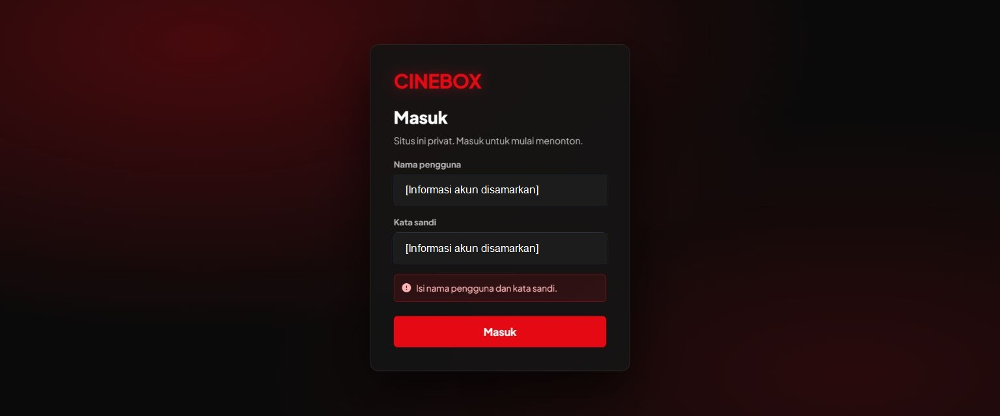

### Langkah 2 — Beranda desktop dan HP: layout HP baik; hero desktop bermasalah

CTA putih/merah mudah dikenali, hierarchy judul jelas, dan baris katalog dapat dijelajahi. Judul panjang pada desktop bertumpuk dengan baris pertama.

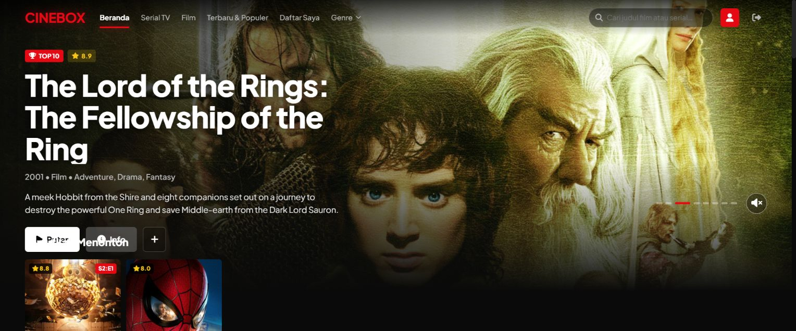

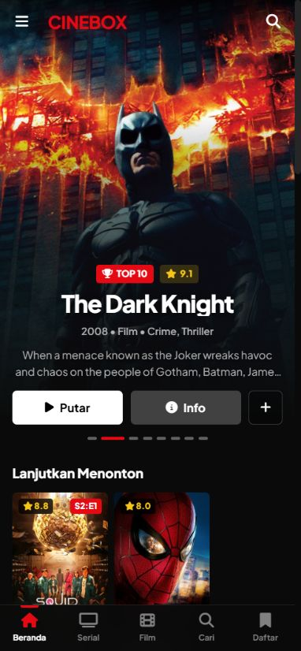

### Langkah 3 — Pencarian: judul berhasil; error dan chip kategori bermasalah

Pencarian Squid Game dan klasifikasi utama Film/Serial berjalan pada respons yang diamati. Jumlah hasil dan keadaan kosong tampil jelas. Gangguan koneksi dan makna chip belum tepat.

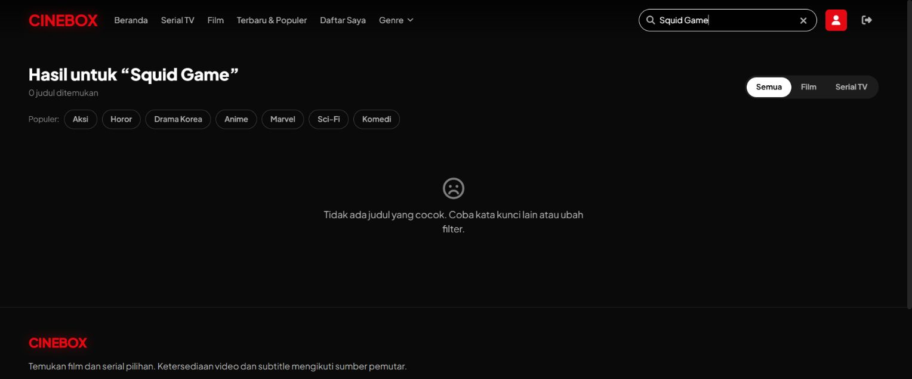

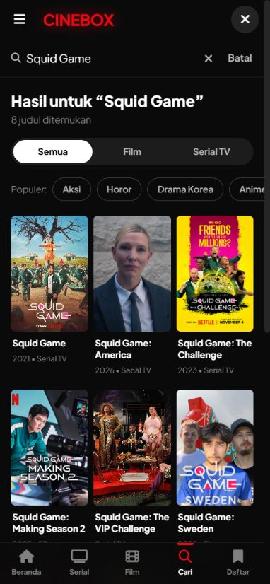

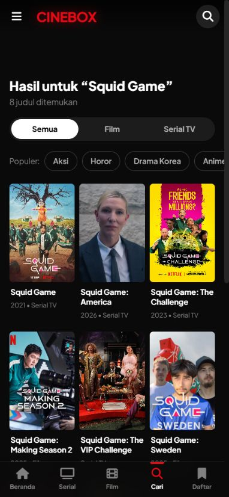

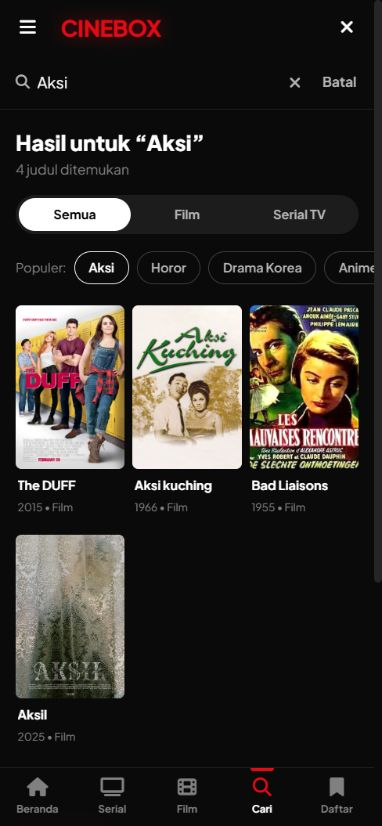

### Langkah 4 — Menu dan genre: menu terbuka; fokus dan hasil filter bermasalah

Menu menampilkan kategori dengan jelas dan menutup setelah memilihnya. Tab dapat keluar ke latar dan kategori Korea tidak sesuai isi.

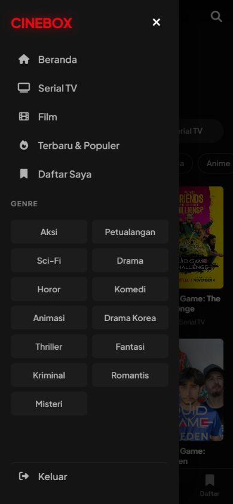

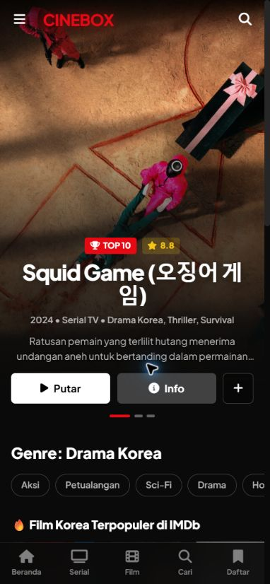

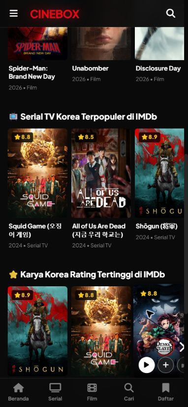

### Langkah 5 — Detail, Daftar Saya, dan Suka: interaksi dasar sehat; identitas Sweet Home salah

Tambah/hapus Daftar Saya dan suka/batal suka mengubah status tombol serta menampilkan feedback. Aksi uji dikembalikan ke kondisi awal; Daftar Saya kembali kosong. Halaman detail menampilkan gambar Dune pada Sweet Home.

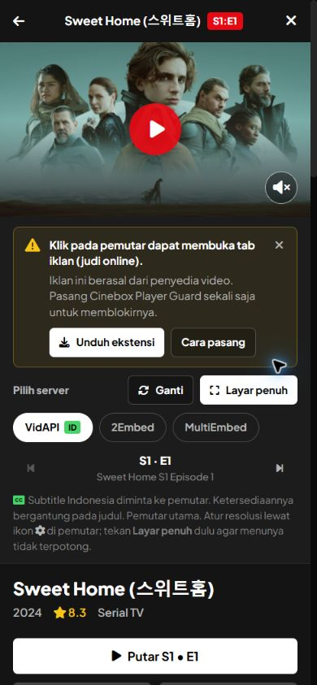

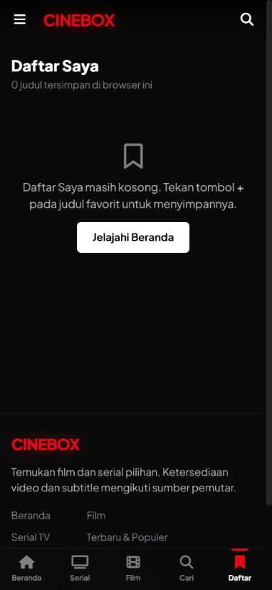

### Langkah 6 — Episode, server, dan layar penuh: episode/server berjalan; fallback fullscreen rusak

Squid Game memuat tiga musim dari metadata sumber. Item riwayat membuka S2:E1, Bread and Lottery. Putar membangun URL episode yang sesuai; berpindah ke VidLink menghasilkan URL TMDB 93405/2/1. Pemutar pihak ketiga memuat video, tetapi fallback fullscreen membatasi iframe dan memotong tombol keluar.

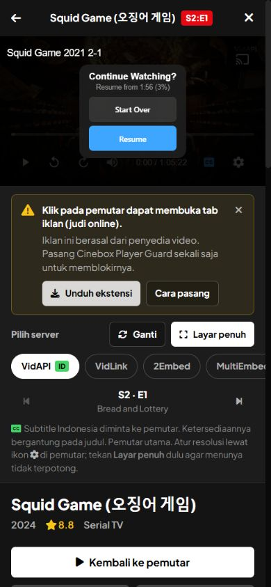

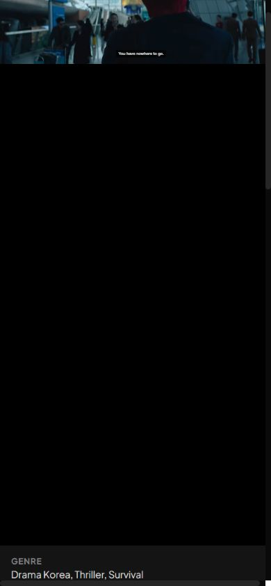

### Langkah 7 — Panduan pemutar: isi terbaca; fokus perlu diperbaiki

Panduan menjelaskan pemasangan ekstensi dan pilihan HP. Escape menutup panduan sambil mempertahankan detail di bawahnya, tetapi fokus tidak dikembalikan ke pemicu. Tampilan ini menjalankan user agent desktop, sehingga bagian komputer memang tampil dahulu.

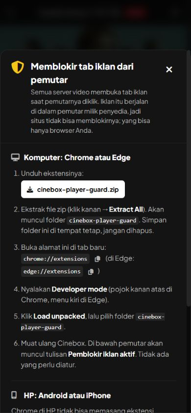

### Langkah 8 — Navigasi dan refresh: navigasi bekerja; state tidak bertahan

Memilih Film menampilkan katalog film. Refresh kembali ke Beranda karena view hanya tersimpan di state React.

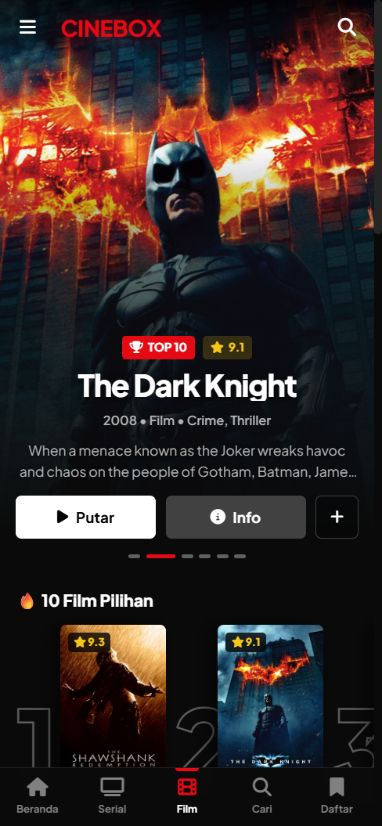

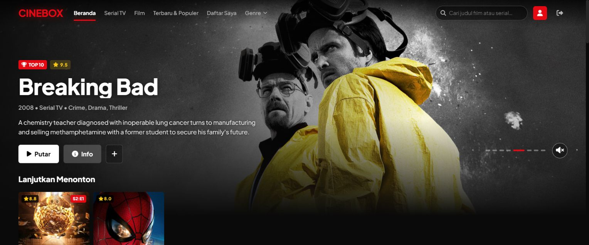

## Validasi dan batas audit

- `node node_modules/typescript/bin/tsc --noEmit` **lolos**. Tidak ditemukan error tipe pada pemeriksaan tersebut.
- Login, katalog, pencarian, detail TV, dan resolusi server melayani respons pada sesi lokal; bukti API disimpan di `api-evidence.json` tanpa cookie/credential.
- Screenshot bukti diambil pada audit ini, disimpan, dan diperiksa. Gambar saat halaman masih memuat ditolak/diganti. Bukti tahun/ID dibandingkan dengan respons API dari sesi ini, bukan laporan audit sebelumnya.
- Pemutar VidAPI memuat prompt resume dan VidLink menampilkan video. Kelancaran video jangka panjang, sinkronisasi subtitle, kualitas semua server, iklan tiap provider, dan download/install ekstensi belum diuji lengkap.
- Tidak dilakukan uji perangkat fisik, Safari, pembaca layar, jaringan lambat terkontrol, atau kepatuhan WCAG menyeluruh. Risiko aksesibilitas di atas didasarkan pada struktur yang dibaca dan interaksi keyboard yang benar-benar dijalankan.
- Tampilan server eksternal dapat berubah. Temuan P1 fullscreen adalah masalah CSS aplikasi yang diukur; identitas Sweet Home adalah data aplikasi yang salah. Jangan menyamakan keduanya dengan gangguan sementara pada penyedia stream.
- Tidak ada perbaikan kode, perubahan deployment, pemasangan ekstensi, atau pengiriman pesan ke pihak lain. Hanya folder laporan/bukti yang ditambahkan ke workspace.

## Urutan perbaikan yang disarankan

1. Koreksi ID Sweet Home dan perbaiki fullscreen cadangan, lalu uji desktop serta perangkat HP.
2. Hilangkan overlap hero dan benahi filter Korea/chip kategori agar sesuai isi.
3. Terapkan focus trap/pemulihan fokus dan bedakan kegagalan pencarian dari hasil kosong.
4. Sinkronkan navigasi ke URL, lalu perjelas perilaku X dan sumber tahun rilis.

Pengumpulan bukti API dapat diulang dari root proyek dengan `node docs/audit-2026-10-30/check-api.cjs` saat server lokal aktif. Script membaca konfigurasi login lokal tanpa mencetak rahasia, lalu menyimpan respons yang sudah bebas cookie/credential.
