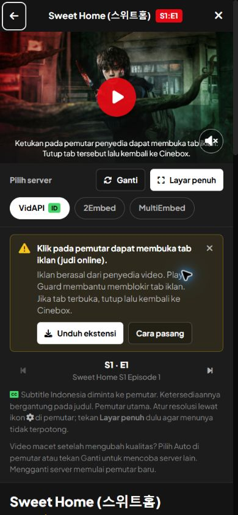
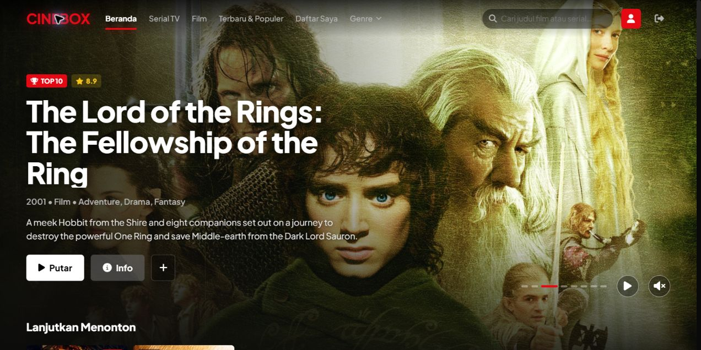

# Perbaikan bertahap audit Cinebox — 30 Oktober 2026

Mengacu pada [audit UI](../audit-2026-10-30/report.md) dan [audit pemutaran mobile](../mobile-playback-audit-2026-10-30/report.md). Delapan temuan utama UI sudah mendapat perbaikan aplikasi. Temuan penyedia video dan pengujian perangkat fisik masih terbuka; tidak semua pemutaran dinyatakan lolos.

## Tahap 1 — Identitas dan fullscreen

- Sweet Home memakai IMDb `tt11612120` pada katalog, gambar, URL server, dan fallback episode. Cache disk lama dinormalisasi saat dibaca.
- Daftar Saya/riwayat dimigrasikan hanya jika ID lama disertai judul Sweet Home dan tipe serial. Urutan serta musim/episode dipertahankan, duplikat disatukan. Dune `tt1160419` tetap dipertahankan. Suka ikut dimigrasikan jika ada bukti judul; ID suka tanpa bukti tidak ditebak. Bila Dune juga tersimpan, kedua suka dipertahankan.
- Fullscreen fallback meniadakan animasi/transform dan backdrop filter pada ancestor selama diperbesar. Iframe tetap pada tempat dan key sumber yang sama, dengan tinggi penuh; tidak dipindahkan melalui portal atau diganti saat fullscreen.
- Tombol keluar 44 px tersedia pada fallback/native. Fokus stage dibatasi saat fullscreen, lalu kembali ke kontrol fullscreen saat keluar.

Detail Sweet Home menampilkan gambar yang benar dan tahun rilis pertama 2020. Fallback episode mengembalikan tiga musim (10/8/8 episode). Fixture lokal menonaktifkan fullscreen native melalui kebijakan iframe untuk menguji fallback terpisah; fixture sudah dihapus sebelum build produksi.

| Uji dari modal yang digulir | Scroll saat diperbesar | Stage dan iframe | Tombol keluar |
| --- | ---: | --- | --- |
| Portrait | 1748 px | x=0, y=0, sekitar 390 × 844 px | y=6–50 px |
| Landscape | 1561,6 px | x=0, y=0, sekitar 844 × 390 px | y=6–50 px |

Bukti pengukuran: [portrait](geometry-portrait.json), [landscape](geometry-landscape.json). Selisih subpixel berasal dari emulasi Chrome. Video eksternal dapat hitam/tidak tersedia dalam pengujian geometri: ukuran iframe penuh tidak membuktikan playback berhasil.

## Tahap 2 — Layout dan kategori

- Hero memakai tinggi minimum dan ruang bawah yang mengikuti tinggi konten. Pada desktop 1280 × 640, judul tiga baris memiliki tombol berakhir di y=513,45 dan heading katalog mulai y=583,45: jarak sekitar 70 px.
- Landscape pendek memakai aturan berdasarkan tinggi viewport. Topbar, stage, dan kontrol server tetap terlihat bersama. Saat modal 844 × 390 digulir sampai bawah, stage berakhir y=286,4 dan kontrol berada y=294,4–342,4; kontrol tidak tertutup video.
- Filter genre memakai metadata genre, bukan kata judul/deskripsi. Korea memakai drama curated atau negara utama produksi; negara studio produksi bersama tidak otomatis menjadikan judul sebagai drama Korea. Serial animasi tetap di Animasi. Kategori kosong tidak diganti film umum dan mendapat pesan kosong di UI.
- Chip kategori pencarian membuka genre. Marvel diberi label “Cari Marvel” karena tetap merupakan pencarian judul.

Katalog produksi sesi ini: Film Korea berisi Hope, Colony, Oldboy; serial berisi Squid Game, All of Us Are Dead, Parasyte: The Grey, Sweet Home. Spider-Man, Shōgun, Jujutsu Kaisen, Solo Leveling, serta animasi produksi bersama tidak muncul. Ini verifikasi keanggotaan kategori, bukan audit ulang seluruh identitas curated.

## Tahap 3 — Fokus, pencarian, pemulihan

- Drawer/detail/panduan menahan fokus, membuat latar inert, dan mengembalikan fokus ke pemicu. Hanya overlay teratas menangani fokus. Backdrop drawer tetap dapat diklik untuk menutup.
- Uji keyboard: Tab dari tombol terakhir drawer/detail kembali ke tombol pertama; penutupan drawer kembali ke “Buka menu navigasi”. Panduan membuat detail inert, lalu penutupannya kembali ke “Cara pasang”.
- Kartu memiliki tombol detail tersendiri, sejajar secara struktur dengan tombol aksi. Tidak ada lagi tombol aksi di dalam `role=button`. Pilihan server memakai radio dengan panah/Home/End.
- Uji kartu pada build produksi: tambah/hapus The Shawshank Redemption memberi toast yang sesuai tanpa membuka detail, dan seluruh empat tombol aksi menerima pointer. Daftar Saya dikembalikan ke kondisi semula; pengujian pemutar menambahkan Sweet Home S1:E1 ke riwayat browser lokal.
- API pencarian membedakan gangguan sumber (502), timeout (504), dan nol hasil sah (200, array kosong). UI menyediakan pesan gagal/Coba lagi; respons lama tidak menimpa pencarian baru.
- Pemberitahuan iklan tersedia sebelum ketukan awal dan menjelaskan menutup tab lalu kembali ke Cinebox. Deteksi Player Guard tidak menjamin semua iklan terblokir. Pesan buffering menjelaskan Auto/Ganti serta bahwa pergantian server membuat pemutar baru.

## Tahap 4 — Navigasi dan konsistensi

- View, genre, kata pencarian, halaman pencarian, dan filter jenis tersimpan dalam URL; dipulihkan setelah refresh dan Back/Forward.
- Uji browser: Film → Serial TV → Back menghasilkan `?view=movie`; Forward menghasilkan `?view=tv`. URL `?view=tv&q=Squid+Game&search=1&filter=tv` bertahan setelah refresh, mengisi input “Squid Game”, dan menampilkan hasil serial. Refresh URL Korea mempertahankan kategori.
- X pencarian membatalkan pencarian dan mengosongkan hasil, selaras dengan Batal. Detail judul belum mempunyai tautan mandiri; modal ditutup saat riwayat halaman dipulihkan.
- Tahun serial curated menunjukkan rilis pertama, termasuk Squid Game 2021, All of Us Are Dead 2022, Sweet Home 2020. Cache/daftar pribadi lama ikut dinormalisasi.
- Hero memiliki jeda/resume, berhenti ketika fokus berada di carousel, dan tidak berganti otomatis pada prefers-reduced-motion.

## Verifikasi akhir

- `npm run test:audit`: **7/7 lolos** — identitas/Dune, migrasi idempotent/urutan, genre/produksi bersama, katalog kosong, pencarian error/timeout/nol hasil, episode, URL.
- `node --test browser-extension/settings.test.mjs`: **5/5 lolos** — aturan ekstensi yang sudah ada; bukan bukti pemasangan/efektivitas langsung.
- `node node_modules/typescript/bin/tsc --noEmit`: **lolos**.
- `npm run build`: **lolos**, termasuk pengemasan ekstensi. Ada peringatan pengunduhan stylesheet Google Fonts untuk optimasi; build tetap selesai dengan sukses.
- `git diff --check`: **lolos** dengan konfigurasi line ending repository.
- Build produksi lokal port 3002: login page 200, katalog tanpa sesi 401, login lokal/katalog Korea berhasil. Screenshot detail final berasal dari build produksi.

## Masih terbuka

1. **Tab iklan penyedia:** peringatan/pemulihan diperbaiki, popup lintas origin belum teratasi. Pemilihan penyedia yang sesuai serta uji langsung Player Guard/Brave/uBlock masih diperlukan. Tidak memasang sandbox yang diketahui memutus kompatibilitas pemutar.
2. **Buffering 720p dan menu internal:** fullscreen menyediakan ruang dan Ganti tetap terjangkau. Penyebab buffering, label aksesibel kontrol VidLink, serta sinkronisasi subtitle membutuhkan verifikasi/perbaikan penyedia.
3. **Semua server:** VidAPI dapat hitam/tidak tersedia pada sesi ini. Playback Sweet Home, resolusi TMDB/VidLink, 2Embed, dan MultiEmbed belum dinyatakan berhasil. URL dipilih/iframe dimuat tidak diperlakukan sebagai playback.
4. **Perangkat fisik:** Android/iPhone, Safari, safe area nyata, sensor rotasi, penguncian orientasi, audio, pembaca layar masih perlu audit ulang. Pemeriksaan di sini memakai Chrome desktop dengan viewport sementara; override dikembalikan setelah uji.

Tidak ada deployment produksi atau pemasangan ekstensi. Audit asli tetap menjadi catatan historis; status perbaikan terbaru ada di laporan ini.
