# Audit mobile, pemutaran, rotasi, dan iklan Cinebox — 30 Oktober 2026

**Hasil: pemutaran dasar berhasil di VidLink, tetapi pengalaman mobile belum lolos audit karena fullscreen cadangan rusak dan tab iklan tetap muncul.** Audit ini menambah laporan dan bukti; kode aplikasi belum diubah.

## Cakupan dan metode

- Website lokal workspace saat ini: `http://localhost:3001`. Port 3000 sedang melayani aplikasi lain.
- Chrome desktop dengan emulasi user agent Android, sentuhan lima titik, portrait 390 × 844, dan landscape 844 × 390 dengan orientasi 90°. Ini bukan perangkat Android fisik atau Safari/iPhone.
- Judul uji: **The Shawshank Redemption**, IMDb `tt0111161`, TMDB `278`.
- Bukti berasal dari sesi audit ini. Waktu video, dimensi, status pause/buffering, dan pilihan menu diperiksa bersama screenshot; gambar perpindahan layout yang belum stabil diganti.
- Tidak memasang ekstensi, tidak berinteraksi dengan transaksi pada halaman iklan, dan tidak mengubah deployment. Tab iklan yang berhasil dikendalikan ditutup.

## Temuan utama

### P1 — Fullscreen cadangan merusak pemutaran dan menyembunyikan tombol keluar

**Langkah 4–5; screenshot 07 dan 10.** Setelah tombol **Layar penuh** Cinebox ditekan, aplikasi memakai `.is-expanded`, bukan fullscreen native.

- Portrait: stage 844 px tetapi iframe hanya 150 px. Posisi iframe `y = -58,4`; tombol keluar `y = -52,4`, seluruhnya di atas viewport.
- Landscape setelah tombol toolbar digulir ke layar: stage `y = -472`, tinggi 390,4 px; iframe hanya 150 px dan tombol keluar `y = -466`. Seluruh pemutar berada di luar layar.
- Escape melalui fokus kontrol halaman bisa keluar, tetapi itu bukan jalan pemulihan yang tersedia bagi pengguna HP biasa.

Kode pendukung: `app/globals.css:474` mengatur `height: auto` pada iframe fallback. `.watch-dialog` mempertahankan transform dari animasi (`app/globals.css:449` dan `:793`), sehingga stage `position: fixed` mengacu pada ancestor yang ikut bergulir. Ukuran dan transform dicatat di [fullscreen-geometry.json](fullscreen-geometry.json).

**Perbaikan yang disarankan:** pastikan iframe mengisi tinggi stage; hindari ancestor ber-transform sebagai containing block fullscreen, tanpa memuat ulang iframe yang sedang bermain; pastikan tombol keluar terlihat dan menerima sentuhan. Uji dari posisi modal yang sudah digulir dalam kedua orientasi. Fullscreen native dan penguncian orientasi sensor perlu uji perangkat terpisah.

### P1 — Kontrol pemutar membuka tab iklan, termasuk situs judi

**Langkah 7; screenshot 12, 13, dan 18.** Klik kontrol Play VidLink ketika film sedang berjalan mem-pause video dan membuka tab Shopee. Setelah tab ditutup dan Play diketuk lagi, waktu film kembali maju dari sekitar 186 detik tanpa reload Cinebox. Dalam rangkaian menu/kualitas/subtitle/fullscreen berikutnya muncul tab **1xBet** pada host `1xlite-12822.pro`; klik pemicu tepatnya tidak diisolasi.

2Embed juga membuka host iklan `interlinecustomroofingllc.com` ketika gambar Play diketuk. Peringatan iklan di Cinebox tampil dan tidak mengaku pemblokir aktif pada emulasi Android, tetapi tidak mencegah pop-up.

**Perbaikan yang disarankan:** prioritaskan penyedia dengan kebijakan iklan yang sesuai untuk produk; pertahankan pemberitahuan sebelum sentuhan pertama dan instruksi kembali ke Cinebox. Jangan menjanjikan pemblokiran dari halaman induk atau menambah sandbox iframe tanpa menguji kompatibilitas penyedia. Brave, uBlock Origin, dan Player Guard belum diuji efektivitasnya pada sesi ini.

### P2 — Layout landscape membuat kontrol penting sulit dijangkau

**Langkah 4; screenshot 06.** Breakpoint mobile berhenti di 768 px, sehingga lebar landscape 844 px memakai layout modal desktop. Stage 804 × 452,25 px lebih tinggi dari viewport 390 px. Pada posisi gulir yang diamati, topbar berada di atas layar dan toolbar di bawah layar. Film tetap berjalan, tetapi tombol kembali, pilihan server, dan fullscreen memerlukan perguliran.

**Perbaikan yang disarankan:** tambahkan aturan landscape untuk layar pendek dan perangkat sentuh; batasi tinggi pemutar menurut tinggi viewport serta pertahankan akses tombol keluar dan pengaturan. Jangan hanya mengandalkan breakpoint lebar.

### P2 — Menu kualitas/subtitle portrait terpotong; perubahan 720p berhenti buffering

**Langkah 8; screenshot 14–17.** Di stage portrait sekitar 215 px, menu kualitas/subtitle perlu digulir; sebagian judul menu berada di atas area iframe. Tombol pengaturan dan captions VidLink juga tidak memiliki nama aksesibel pada DOM yang diperiksa.

Pemilihan 720p mengubah pilihan menu tetapi video berhenti pada `313,359059` detik, `paused: false`, `readyState: 2`; pemeriksaan berulang selama menu subtitle dan fullscreen tetap menunjukkan waktu yang sama. Memilih Auto belum memulihkannya dalam jendela pengamatan. Tidak ada error media yang dilaporkan. Ini gejala stream/penyedia pada sesi ini, bukan bukti bahwa semua video 720p selalu gagal.

Subtitle **Indonesian** tersedia dan berhasil dipilih: teks berubah menjadi “Dan yang paling utama...”. Karena video masih buffering, sinkronisasi subtitle saat playback Indonesia berjalan belum terverifikasi.

**Perbaikan yang disarankan:** benahi fullscreen sebagai ruang menu; sediakan cara mengganti server saat stream berhenti. Label kontrol internal VidLink membutuhkan perbaikan dari penyedia. Ulangi perubahan kualitas pada perangkat fisik dan jaringan lain sebelum menyimpulkan penyebab stream.

### P2 — Beberapa server belum memberikan pemutaran yang dapat diverifikasi

**Langkah 3 dan 9; screenshot 03 dan 19–20.** VidAPI memuat kontrol lalu iframe menjadi hitam. Log penyedia menyebut pembatasan DevTools. Tidak dilakukan bypass; hasil ini mungkin dipengaruhi lingkungan audit. Di 2Embed, dua ketukan Play masih menyisakan poster dan iframe anak `about:blank`, dengan tab iklan pada ketukan pertama. Ini tidak membuktikan server tersebut gagal pada semua browser.

MultiEmbed belum diuji: upaya memilihnya terhalang panel ekstensi browser. Status server harus dibedakan antara **URL berhasil dipilih**, **player berhasil dimuat**, dan **video benar-benar berjalan**.

## Alur dan bukti visual

### 1. Beranda mobile — baik pada portrait

Kartu film dan navigasi bawah tampil; judul serta CTA terbaca.

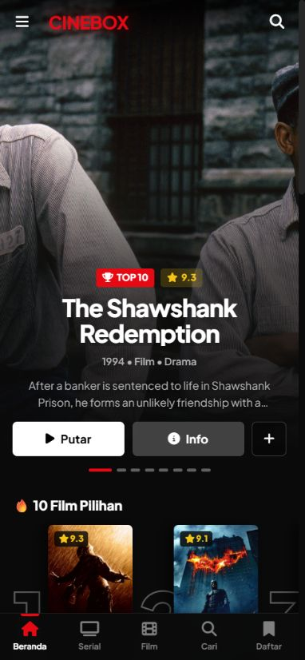

### 2. Detail film dan pemberitahuan iklan — baik, chip server harus digeser

Detail membuka judul yang sesuai. Pemberitahuan Android tampil sebelum film dimulai. Chip MultiEmbed berada di sisi kanan baris yang dapat digeser.

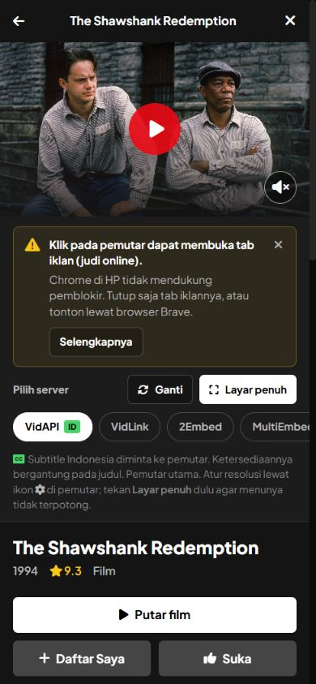

### 3. Mulai film — VidLink berhasil; VidAPI terhalang

VidAPI menjadi hitam setelah sempat menampilkan kontrol. VidLink benar-benar memutar video 1920 × 1080 dengan durasi 8553,4 detik, `paused: false`, `readyState: 4`, tanpa error media. [playback.json](playback.json) mencatat waktu sekitar 19,75 detik sebelum rotasi.

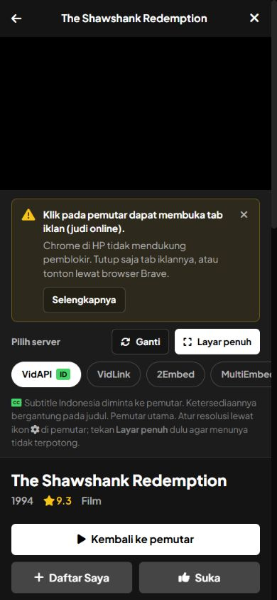

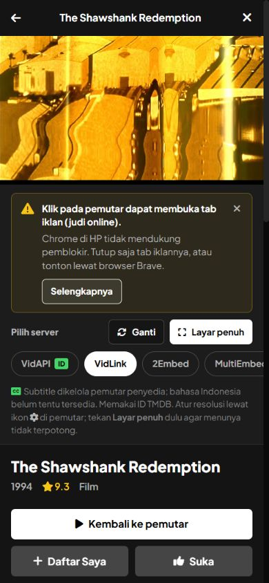

### 4. Rotasi landscape — video berlanjut, layout perlu perbaikan

Waktu video maju menjadi sekitar 20,17 detik segera setelah rotasi. Tidak terjadi reload iframe dalam pengamatan tersebut. Layout stabil menampilkan video melebihi tinggi layar dan memindahkan kontrol keluar viewport.

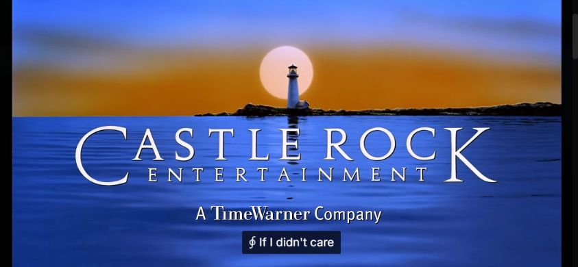

### 5. Fullscreen landscape dan portrait — gagal pada fallback

Landscape menggeser seluruh stage keluar layar. Portrait menampilkan strip iframe 150 px dan menyembunyikan tombol keluar. Tombol fullscreen penyedia juga tidak menghasilkan fullscreen native yang dapat diverifikasi pada sesi ini.

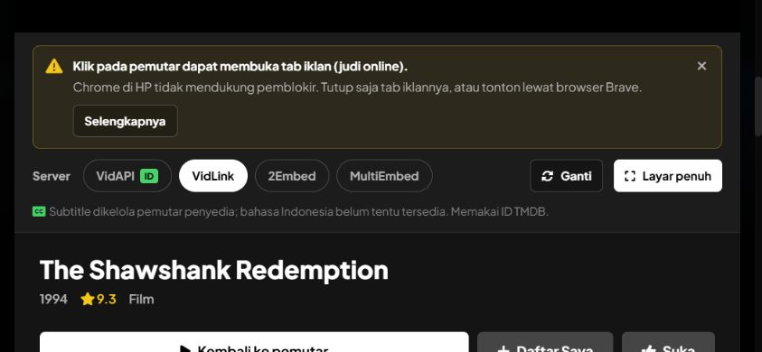

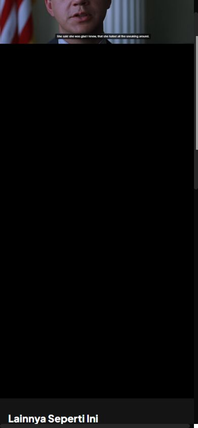

### 6. Kembali portrait dan panduan HP — berhasil

Escape melalui kontrol halaman keluar dari fallback; **Kembali ke pemutar** memulihkan posisi modal. Video tetap berjalan pada sekitar 73,81 detik. Panduan memprioritaskan Android/iPhone dan menjelaskan kembali dari tab iklan.

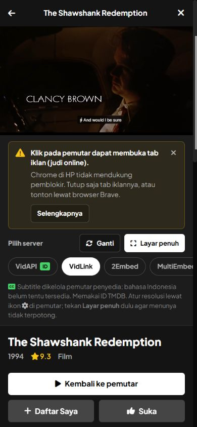

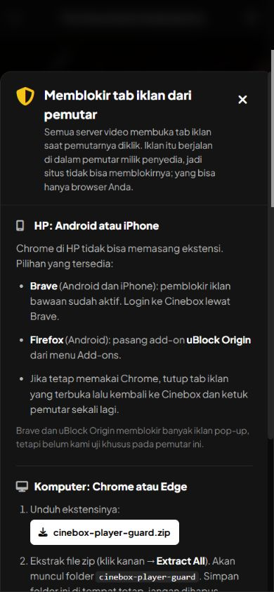

### 7. Pause, iklan, dan resume — fungsi video berhasil; iklan mengganggu

Pause menghasilkan `paused: true` sekitar 186,38 detik. Tab Shopee muncul; sesudah ditutup, resume menghasilkan `paused: false`, `readyState: 4`, sekitar 186,48 detik. Tab 1xBet juga muncul selama pengujian kontrol berikutnya. Mute/unmute mengubah status media dan dikembalikan ke mute.

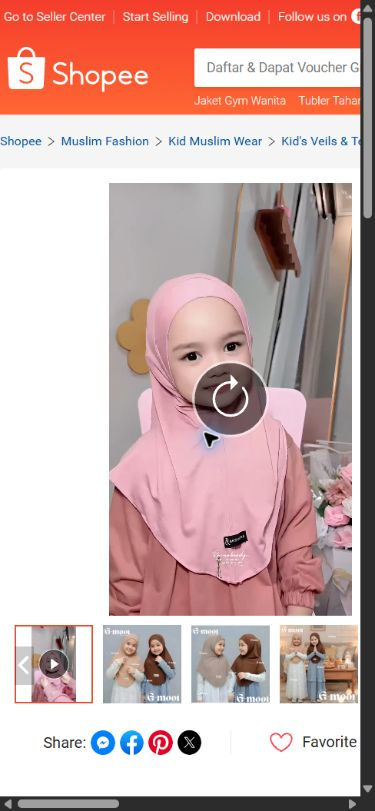

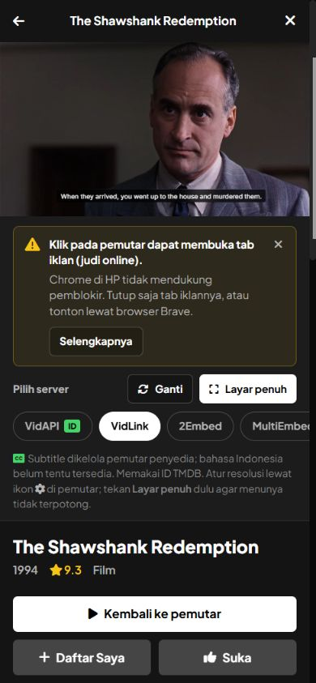

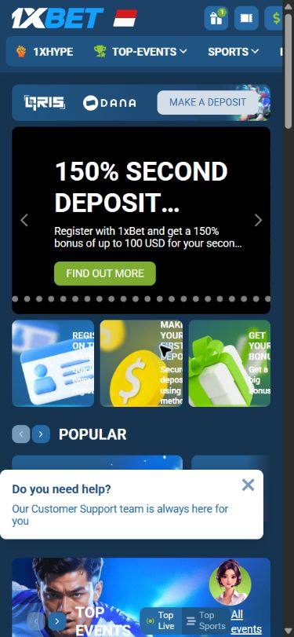

### 8. Kualitas dan subtitle — pilihan bekerja; menu sempit dan buffering

Menu menyediakan Auto, 1080p, 720p, dan 480p. Pilihan 720p aktif, tetapi waktu film berhenti pada 5:13. Subtitle Indonesian aktif dan teks terjemahan tampil; pemutaran setelah perubahan kualitas belum pulih dalam pengamatan.

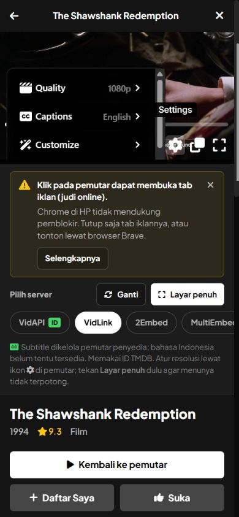

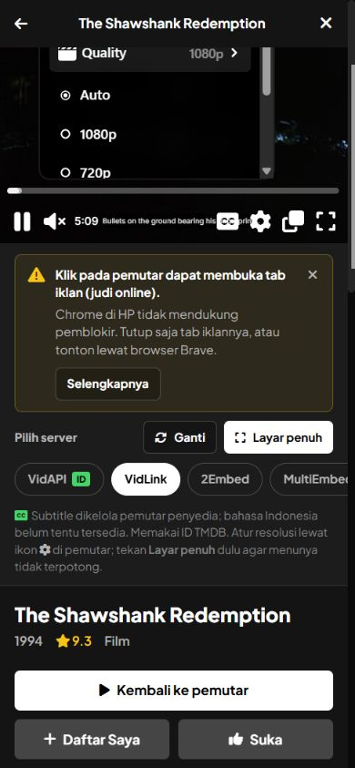

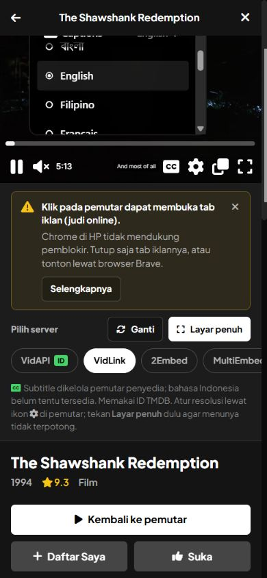

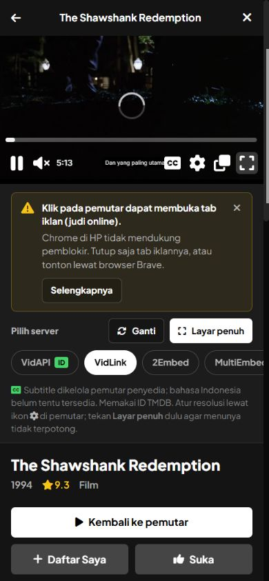

### 9. Server cadangan — 2Embed belum memutar; MultiEmbed terhalang

2Embed membuka poster yang sesuai dan tab iklan, tetapi iframe anak masih `about:blank` setelah dua ketukan Play. Pengujian MultiEmbed tidak selesai karena browser terhalang panel ekstensi.

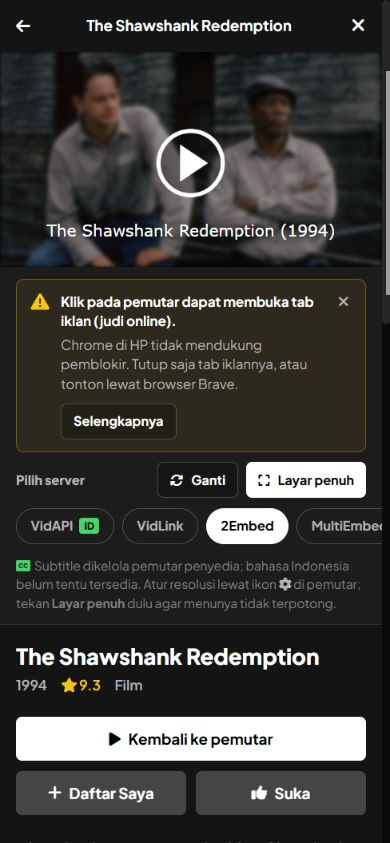

## Batas bukti dan status akhir

- Belum menguji perangkat fisik, Safari, sensor rotasi, safe area notch asli, fullscreen native yang berhasil, penguncian orientasi, audio yang didengar manusia, atau keseluruhan durasi film.
- Tidak ada klaim kepatuhan WCAG penuh. Risiko yang terlihat: kontrol 32 px yang padat, tombol pengaturan/captions tanpa nama aksesibel, dan tombol keluar fullscreen di luar viewport. Pembaca layar belum diuji.
- Gejala buffering 720p, pembatasan VidAPI, dan kegagalan 2Embed dapat dipengaruhi penyedia atau lingkungan sesi. Bug geometri fallback didukung pengukuran dan kode CSS aplikasi.
- Browser melaporkan panel ekstensi lain menghalangi otomasi. Percobaan observasi native kemudian dihentikan karena URL browser Windows tidak dapat dipastikan untuk pemeriksaan kebijakan. Kontrol browser dihentikan; MultiEmbed serta reset emulasi di akhir tidak dapat diverifikasi. Override portrait/user agent/sentuhan mungkin masih aktif pada tab audit.
- Laporan ini tersimpan bersama screenshot dan JSON bukti di `docs/mobile-playback-audit-2026-10-30/`. Tidak menggunakan bukti audit lama untuk menyimpulkan temuan di atas.

**Urutan tindak lanjut:** perbaiki fullscreen dan landscape terlebih dahulu; tangani pengalaman iklan; ulangi pergantian kualitas/server pada HP fisik; kemudian verifikasi subtitle, nama kontrol, dan pemulihan dari gangguan jaringan.
